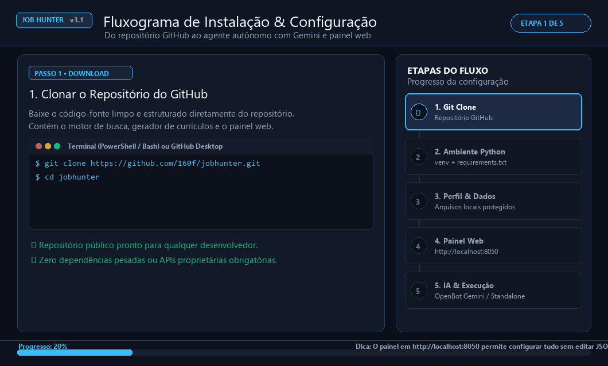

# Job Hunter — Agente Autônomo de Busca & Painel de Candidaturas

O **Job Hunter** é uma solução completa para automação de busca de vagas remotas, triagem criteriosa de compatibilidade com perfil profissional, geração dinâmica de currículos em PDF e acompanhamento do ciclo de vida de processos seletivos.

O projeto foi construído para operar tanto integrado a agentes locais (como **OpenBot**) quanto de forma autônoma via painel web interativo e scripts em Python.



---

## Principais Funcionalidades

- **Varredura Multi-API de Oportunidades:** Consulta automatizada a APIs públicas de vagas (Greenhouse, Himalayas, Remotive, RemoteOK, Arbeitnow, Ashby) sem scraping intrusivo ou risco de bloqueio.
- **Triagem Criteriosa & Deduplicação:** Filtros eliminatórios automáticos (modalidade 100% remota, elegibilidade geográfica, barreiras de idioma e exigência de diploma formal) e pontuação de aderência técnica (Score 0–100).
- **Painel de Controle Visual (FastAPI + HTML):**
  - **Aba Painel:** Visão geral com cartões KPI, radar de vagas, gráfico geográfico e filtros rápidos.
  - **Aba Rotinas:** Monitoramento dos agendamentos diários (09h00, 15h00 e checagem de e-mails às 18h00), histórico das últimas execuções e botões para disparo manual com diagnóstico técnico em tempo real.
  - **Aba Configurações:** Gestão de plataformas, cargos/frentes de busca, regimes contratuais (CLT/PJ) e modo de envio (aprovação manual ou automático).
- **Geração de Currículos sob Medida (PDF):** Montagem de currículos customizados por oportunidade, destacando as competências reais do candidato sem alucinações ou invenções.
- **Acompanhamento de Retornos por E-mail:** Rotina diária de verificação para registrar convites para entrevista ou encerramentos.

---

## Estrutura do Repositório

```text
├── AGENTS.md                            # Diretrizes operacionais e regras de comportamento do agente
├── painel.py                            # Servidor web e interface interativa do usuário (FastAPI)
├── requirements.txt                     # Dependências do projeto
├── perfil_cv_referencia.example.txt     # Modelo de referência para preenchimento do currículo/perfil
├── config_painel.example.json           # Modelo de preferências e plataformas configuradas
├── vagas.example.csv                    # Cabeçalho do arquivo de histórico de vagas analisadas
├── candidaturas_acompanhamento.example.csv # Cabeçalho do histórico de acompanhamento de envios
├── curriculos/                          # Diretório onde os PDFs gerados são armazenados
└── scripts/
    ├── job_hunter_v3_1.py               # Motor de busca multi-API e pré-filtragem
    ├── config_job_hunter_v3_1.json      # Configuração de endpoints e parâmetros das buscas
    └── gerador_curriculo.py             # Script de suporte para geração de currículos em PDF
```

---

## Como Instalar e Rodar

### 1. Pré-requisitos
- Python 3.10 ou superior instalado.
- Git instalado na máquina.

### 2. Configurar o Ambiente

Clone o repositório e crie um ambiente virtual:

```bash
git clone https://github.com/SEU_USUARIO/job-hunter.git
cd job-hunter
python -m venv venv

# Ative o ambiente virtual:
# No Windows (PowerShell):
.\venv\Scripts\Activate.ps1
# No Linux/macOS:
source venv/bin/activate

# Instale as dependências:
pip install -r requirements.txt
```

### 3. Configurar os Arquivos Iniciais

Copie os modelos de exemplo para criar seus arquivos de trabalho locais:

```bash
# Criar o arquivo de perfil do candidato:
copy perfil_cv_referencia.example.txt perfil_cv_referencia.txt

# Criar a configuração do painel:
copy config_painel.example.json config_painel.json

# Criar os arquivos de histórico:
copy vagas.example.csv vagas.csv
copy candidaturas_acompanhamento.example.csv candidaturas_acompanhamento.csv
```

Abra `perfil_cv_referencia.txt` no seu editor e insira suas qualificações, competências, histórico profissional e preferências reais.

> [!TIP]
> **Configuração Visual pelo Painel:** Você não precisa editar arquivos `.json` manualmente! Ao iniciar o painel web, acesse a aba **⚙ Configurações** para habilitar plataformas de busca, escolher cargos-alvo, definir modalidades e regimes (CLT/PJ), ajustar o horário da checagem diária de e-mails e alternar o modo de envio com apenas alguns cliques.

### 4. Iniciar o Painel Web

Inicie o servidor com:

```bash
python painel.py
```

Abra no seu navegador: **[http://localhost:8050](http://localhost:8050)** (ou a porta indicada no terminal).

---

## Execução das Rotinas de Busca

- **Pelo Painel:** Acesse a aba **Rotinas** e clique em **Disparar Busca Agora** ou **Disparar Incremental Agora**. O painel exibirá o diagnóstico técnico de anúncios consultados e novas vagas encontradas.
- **Pela Linha de Comando:** Execute diretamente o script de busca:
  ```bash
  python scripts/job_hunter_v3_1.py
  ```
- **Integrado a Agentes (OpenBot):** As instruções em `AGENTS.md` orientam o agente a respeitar as rotinas diárias e consultar `perfil_cv_referencia.txt` como fonte única de verdade.

---

## Como Importar e Usar no OpenBot (com Gemini)

Integrar o **Job Hunter** no **OpenBot** com um modelo **Gemini** (Google) é a melhor combinação para automação completa, pois o Gemini possui excelente capacidade analítica e facilidade de integração com o Gmail para auditoria automática de retornos de candidaturas.

### Passo a Passo de Importação:

1. **Clonar o Repositório:**
   Clone o repositório para o diretório de agentes do seu OpenBot:
   ```bash
   git clone https://github.com/160f/jobhunter.git "C:\Users\<SEU_USUARIO>\OpenBot\Agents\jobhunter"
   ```

2. **Criar o Agente no OpenBot:**
   - Abra o **OpenBot**.
   - No menu lateral esquerdo, clique no botão **`+` (Novo Agente)**.
   - **Nome:** Digite `Job Hunter`.
   - **Pasta de Trabalho (Workspace):** Aponte para a pasta clonada (`.../OpenBot/Agents/jobhunter`).
   - **Modelo (LLM):** Selecione **Gemini** (ex: `Gemini 1.5 Pro` ou `Gemini 2.0 Flash`).
   - **Instruções:** O OpenBot carrega automaticamente o arquivo [AGENTS.md](AGENTS.md) da raiz. Na descrição do perfil, você pode resumir a meta (ex: *Agente autônomo de busca de vagas remotas, triagem e acompanhamento*).

3. **Configurar as Rotinas Automáticas:**
   Na aba **Rotinas** do OpenBot (ou via chat com o agente), configure os três agendamentos diários:
   - **09:00 — Busca Principal de Vagas:** Dispara a varredura matinal de APIs e triagem de novas oportunidades.
   - **15:00 — Busca Incremental:** Consulta rápida para capturar anúncios recém-publicados.
   - **18:00 — Verificação Diária de E-mail (Gmail):** O agente com Gemini consulta os e-mails do dia buscando retornos de candidaturas (*"entrevista"*, *"interview"*, *"processo seletivo"*, *"rejeição"*) e atualiza os status nos arquivos CSV.

4. **Iniciar o Painel Web do Agente:**
   Para acompanhar visualmente pelo painel interativo, basta rodar no terminal da pasta:
   ```bash
   python painel.py
   ```
   E acessar `http://localhost:8050`.

---

## Segurança e Privacidade

O arquivo `.gitignore` deste repositório foi pré-configurado para **nunca subir dados pessoais**:
- Currículos preenchidos (`perfil_cv_referencia.txt` e `.md`) permanecem apenas na sua máquina.
- Currículos gerados em PDF na pasta `curriculos/` são ignorados pelo versionamento.
- O histórico pessoal de candidaturas em `vagas.csv` e `candidaturas_acompanhamento.csv` é mantido localmente.
